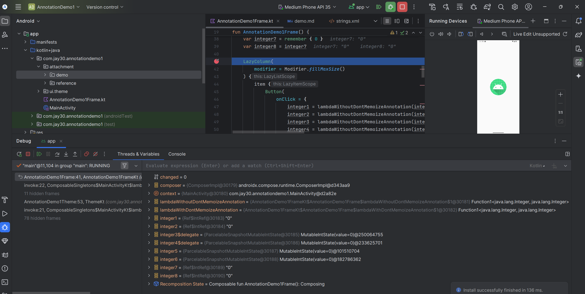
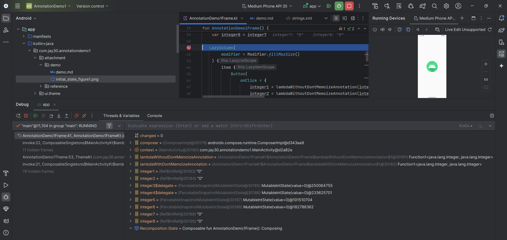
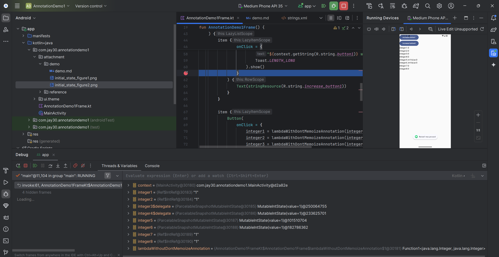
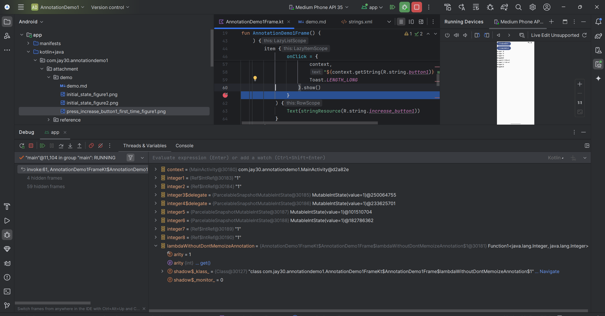
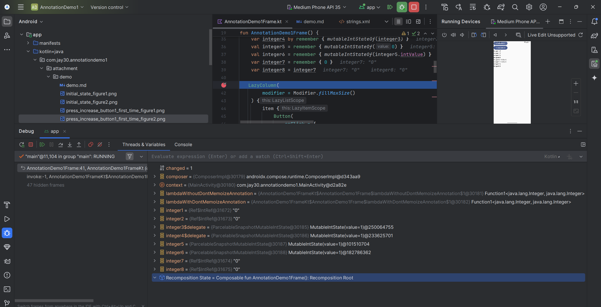
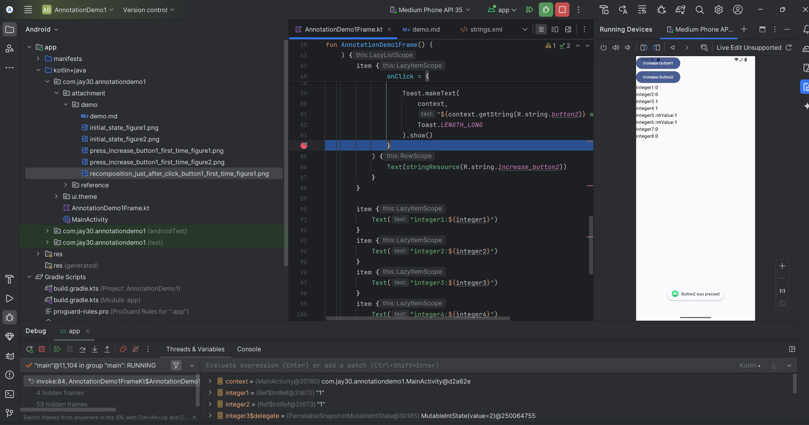
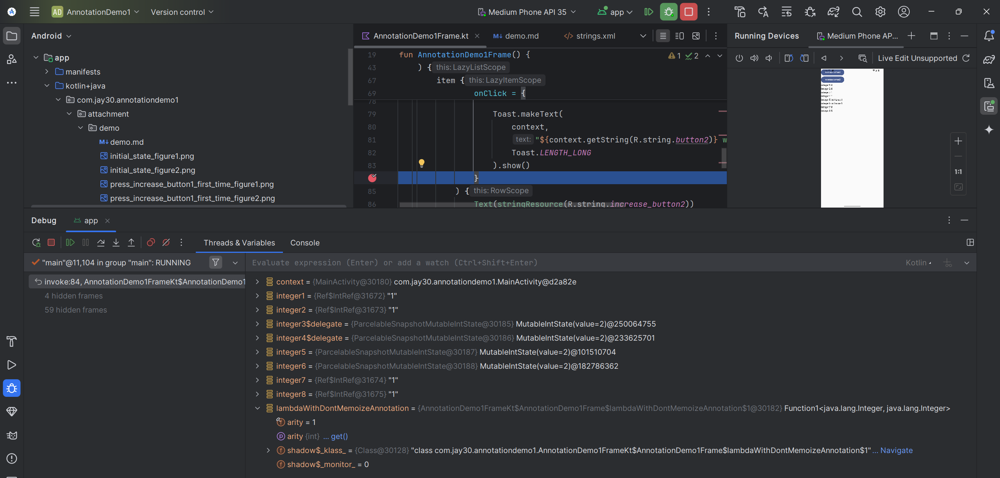
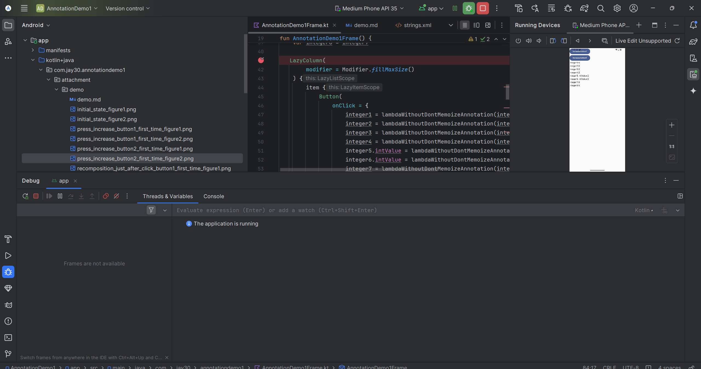

# demo
During execution with debugger,

+ At initial state, I get

+ when I click `Increase button1`, I get 

+ at recomposition just after I click `Increase button1`, I get 

+ when I click `Increase button2`, I get 

+ at recomposition just after I click `Increase button2`, I get 
