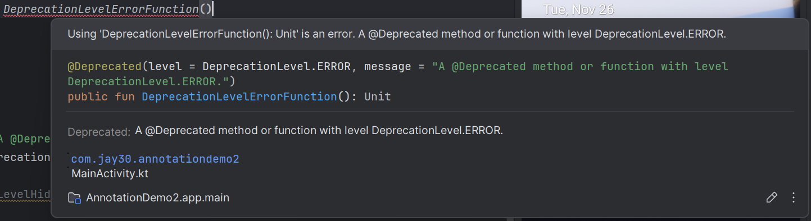

# demo
These following figures illustrate how to use `@Deprecated` annotation and difference of deprecated level (`level` argument in `@Deprecated` annotation).

+ keywords tip when type the word `Depr`.

+ docs about a function or method annotated with `@Deprecated` annotation in deprecation level Error.

+ [docs about a function or method annotated with `@Deprecated` annotation in deprecation level Warning.](https://youtu.be/qZAyp3DtWv4)

> [!NOTE]
> There are no keyword tips about function or method with `@Deprecated` annotation in deprecation level hidden.
> 
> Of course, there are no docs about it.